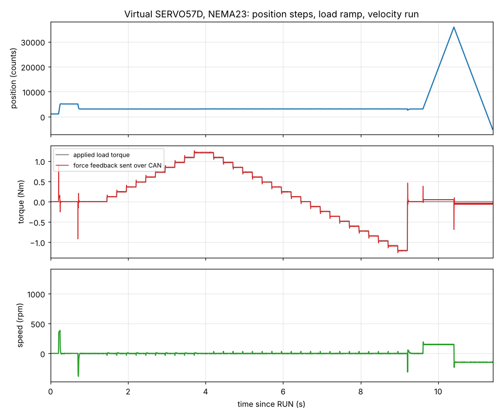
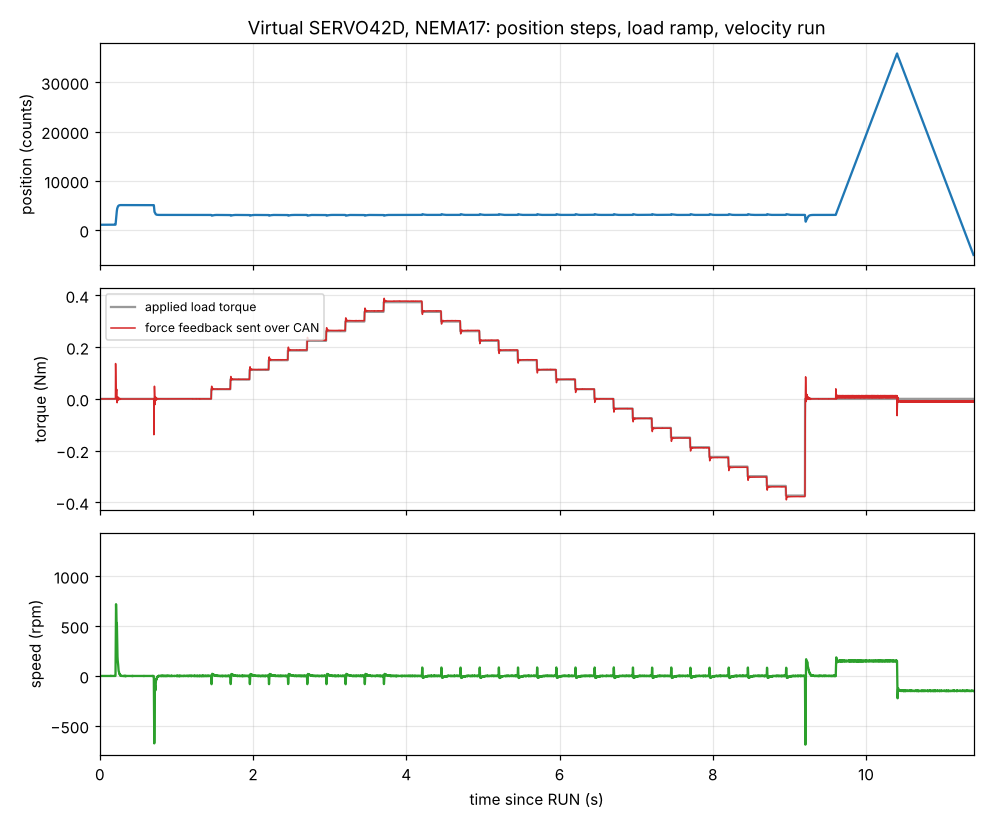

# Control core and virtual drive

`ctrl/` is a closed-loop stepper controller with force feedback over CAN. It is plain C with
float, no register access and no stmbl dependencies, so the same files run on the
Cortex-M4F and in `sim/`, a model of the whole drive (motor, bridges, shunt amplifier, ADC,
encoder, CAN), built for either board: `make -C sim check` runs 493 checks for each, SERVO57D
(NEMA23) and SERVO42D (NEMA17), in about 50 s. The board is a build flag, `-DSV_BOARD_57D` or
`-DSV_BOARD_42D`, which picks `ctrl/servo_hw_57d.h` or `servo_hw_42d.h` (shunt value, divider,
sense signs) and `sim/sim_board.h` (motor and gains of the virtual drive); see `hardware_42d.md`.

| SERVO57D | SERVO42D |
|---|---|
|  |  |

The plots are `make trace_57d.csv trace_42d.csv` plotted: two position steps, a load ramp to
89 % of the drive's torque limit and back, then a velocity run. The red trace is the force
feedback the drive sends over CAN.

## What the core does

Rates: current loop 20 kHz (one PWM period), velocity and position 2 kHz.

1. **Calibrate (`SV_CAL`).** All legs at 50 %, so no coil voltage. Averages 128 samples of
   each current channel to get the zero-current offsets. It waits for the shaft to stand
   still (a moving rotor would put back-EMF current into the offsets); 3 s without a
   standstill is a fault.
2. **Align and find direction (`SV_ALIGN`, `SV_PHASE_DIR`, `SV_PHASE_NEG`).** About 2 s. A
   current vector holds at electrical angle 0; it then turns slowly to +90 degrees (0.2 s) and on
   to -90 degrees (0.4 s). The rotor follows the vector, so it can only move with it or stay held;
   a jump to a new equilibrium could alias into the wrong direction. The encoder is averaged at
   the three points. A free shaft moves a quarter electrical turn between them (82 counts for 50
   pole pairs). A step counts only within 15 % of that and with the right sign, and the
   direction and the electrical offset come from the steps that count. So a shaft held by an
   endstop in one direction is still phased from the free one; if no step counts (blocked
   or disconnected shaft, wrong pole-pair setting, a stop in both directions) it is a
   `SV_FLT_PHASING` fault: the safe outcome, since a wrong direction would be positive feedback.
   `raw * pole_pairs mod 16384` is the exact electrical angle.
3. **Run (`SV_RUN`).** Field-oriented: the coil currents are projected on the rotor flux axis
   (`id`, `iq`). `id = 0`, `iq` is the torque current. The PI controllers are tuned by
   pole-zero cancellation from the configured `R`, `L` and bandwidth (1 kHz), with
   decoupling and back-EMF feed-forward. A cascade velocity PI and position P produce `iq`.
   The encoder angle is advanced by 1.5 sampling periods (the SPI value is one period old
   and the PWM update lands half a period after the sample).
4. **Force estimate.** `torque_nm = Kt * (iq - detent feed-forward)`, low-passed at 200 Hz.
   With `detent_nm = 0` it contains the detent ripple.
5. **Protection.** Overcurrent (`i_trip`), supply under / over voltage, No_Mag, encoder parity
   streak. A fault puts all legs low (brake). Stall (current at the limit with a position
   error over 200 counts for 0.2 s) is a status flag, not a fault.

Size on the M4F (`-Os`, hard float): about 6.9 kB flash for the four files (the parameter table is about 3 kB of it) plus `sinf`, `cosf`
and `sqrtf` from the library, and 360 bytes of RAM for the state (344 + 16).

## CAN protocol

Defined in `ctrl/can_proto.h` (11-bit IDs, little endian, node id `n`):

| frame | ID | content |
|---|---|---|
| command | `0x100+n` | enable, mode, torque / velocity / position target, current limit, stream period, **get / set / enumerate / save any parameter**, restore defaults, read once, clear fault |
| reply | `0x080+n` | command code, status (0 ok, 1 bad argument, 2 unknown) |
| parameter reply | `0x380+n` | command code, status, parameter id, value (4 bytes) |
| telemetry A | `0x180+n` | position (counts, multi-turn), position error, state / mode / stall, fault bits |
| telemetry B | `0x280+n` | **iq (mA), torque (mNm)**, speed (0.1 rpm), supply (10 mV) |

### Parameters

Every setting and every measured value is a parameter with a fixed id, type, range, unit and flags, in one table (`ctrl/params.c`; list in `can_params.md`): 44 of them, 24 writable, 19 in the saved set. CAN commands `0x30` set, `0x31` get, `0x32` info (type, flags, minimum, maximum), `0x33` enumerate by index, `0x35` save, `0x36` restore defaults.

- **Checked on write:** the range, NaN / infinity, read-only, and relations (`vbus_min < vbus_max`, the runtime current limit at most `i_max`). The reply carries the value now stored, so a refused write shows what is still in effect.
- **Drive off only:** motor R, L, pole pairs, current-loop bandwidth and the align current can only change while the drive is off or faulted (status 5 otherwise). Changing R, L or the bandwidth recomputes the current-loop PI gains.
- **Saved set:** `params_save` serialises the 19 saved parameters (120 bytes with a header and CRC-16); `params_load` applies a blob only if the CRC and the length are right and the drive is off, and skips values out of range. Writing the blob to flash is the MCU glue's job (`can_proto_t.save_cb`); without it the save command answers status 6. The simulator stores it in RAM and checks the round trip across a restart.
- **Not parameters:** the CAN bit rate is a hardware setting and is not on this list yet.

Telemetry is sent only on request (`0x40`) or at the period set by `0x21`. It is a different protocol
from MakerBase's (frame layout and command codes); the stock manual's commands are not
implemented.

## Results on the virtual drive

Virtual motors, both 24 V, 50 pole pairs:

| | SERVO57D (NEMA23) | SERVO42D (NEMA17) |
|---|---|---|
| coil | 0.9 ohm, 3.5 mH | 1.6 ohm, 3.0 mH |
| Kt, detent | 0.45 Nm/A, 0.05 Nm | 0.21 Nm/A, 0.02 Nm |
| inertia | 5e-5 kg m^2 | 5.4e-6 kg m^2 |
| current limit, torque limit | 3 A, 1.35 Nm | 2 A, 0.42 Nm |

Numbers from `make -C sim check`:

| test | SERVO57D | SERVO42D |
|---|---|---|
| offset calibration | within 0.1 LSB; waits 34 ms for a shaft still rolling into a detent | within 0.2 LSB; waits 16 ms |
| phasing | flux angle error under 0.3 degrees, 3 start angles, both magnet orientations | under 0.1 degrees |
| **phasing against a hard endstop** | 64 starts (both stop sides, both encoder orientations, 16 start phases): 35 phased (worst flux error 1.0 degrees), 29 refused with a phasing fault, **0 wrong** | 38 phased (1.1 degrees), 26 refused, **0 wrong** |
| current step (rotor blocked), 2/3 of the limit | 10–90 % rise 360 us, 0.4 % overshoot, 1 % low | 320 us, 0.7 %, 1 % low |
| position steps 2000 / 5000 / 16384 counts | settle (+-8 counts) in 45 / 121 / 234 ms, 0 counts final error | 53 / 69 / 143 ms, 0 to 1 count |
| velocity 120 rpm | within 0.1 %, reverse too | within 0.1 % |
| **force feedback over CAN** | within 0.011 Nm of the load over +-1.1 Nm (81 % of the limit) | within 0.004 Nm over +-0.34 Nm (81 %) |
| overload (118 % of the limit) | stall flag, torque telemetry saturates at the limit, lost steps recovered when the load goes | same |
| motor parameters wrong | R +50 % / L -40 %, R -33 % / L +50 %: position error 0, torque correct; Kt +20 %: torque reads 20 % high | same |
| no detent compensation | hunts about +-30 counts, torque 9 % low at 37 % of the limit | hunts +-55 counts (the NEMA17's detent is a larger share of its torque), torque 8 % high |
| faults | undervoltage, parity streak, No_Mag, blocked shaft trip; two parity glitches ignored; clears over CAN | same; the trip level is clamped to 90 % of the sensing range |

**At an endstop.** Phasing needs the shaft free to move about 1.8 degrees either way. Pressed against a stop with no play it works about half the time (when the stop is on the far side of the vector's travel) and otherwise stops with a phasing fault; move the axis off the stop and enable again. Use a lower `i_align` there: the align current pushes against the stop for about 2 s. A first version that jumped the vector between equilibria accepted a wrong, reversed direction in one of 12 test starts; the slow turn removed that.

What the simulator found while it was being built (all fixed in the core): calibration run
while the shaft was still moving put 16 LSB (0.1 A) of error on one channel; position
gains that looked reasonable stuck against the 0.05 Nm detent and hunted; an overload test
with a constant torque load accelerates the rotor without limit, so the test needs a speed-
dependent load.

## What the simulator models, and what it does not

Modelled at 62.5 ns steps: the center-aligned TIM3 compare with the update at the valley, the
EG3013 dead time and body diode conduction, FET on resistance, the shunt seeing the
current only while its leg's low FET conducts, the amplifier's settling and offsets and
the gain error, ADC clock, sampling and conversion time per channel, ADC noise, the
MT6816 SPI frame with parity and No_Mag and a one-period-old angle, the motor (two coils, back-
EMF, detent, viscous friction, inertia, external load), and the CAN mailboxes at 1 ms.

Not modelled: iron losses and saturation, coil mutual coupling, CAN bit timing and
arbitration, supply sag and regeneration into the supply (a motor decelerating from
speed charges the bus on a real board), temperature, FET switching edges, and the
interrupt-latency jitter of the real MCU. The motor numbers are typical catalogue values,
not measured, and the FET on-resistance of the 42D (AP4008QD) is an assumption. A passing run here shows the algorithm and the wiring assumptions are
consistent; it does not show the board works.

## Not done: the MCU glue

`ctrl/` is not called from `src/` yet. To run on the board it needs, in `src/drivers/`:

1. TIM3 center-aligned at 20 kHz, `phase*` pins as TIM3 PWM outputs, compare registers
   loaded at the valley, and an ISR (or ADC end-of-conversion) at the peak.
2. The ADC triggered from TIM3 (or clocked fast enough) so that both current samples
   land in the low-on window, see `hardware.md`.
3. The MT6816 read each period (`mt6816_request()` / `mt6816_decode()`).
4. CAN receive and the 1 ms tick feeding `can_proto_rx` / `can_proto_tick_ms`.
5. `-mfpu=fpv4-sp-d16 -mfloat-abi=hard` in `CMakeLists.txt` (it builds soft-float now) and
   `-lm`. For the 42D also the pin map of the N32L403 (`hardware_42d.md`) and its SDK variant.
6. A first bench step before any motor: check the sense signs and offsets with the motor
   disconnected, then spin it open loop at low current.

Open items for a real motor: `r_ohm`, `l_h`, `kt`, `pole_pairs`, and the detent amplitude
and phase (`detent_nm`, `detent_phase`) must be measured or identified; the velocity and
position gains in `sim_default_cfg()` are tuned for the simulated motor and load.
